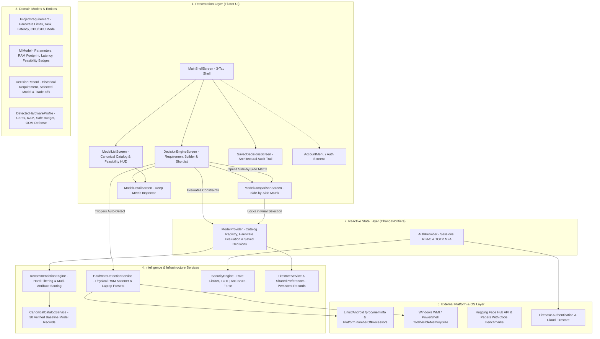
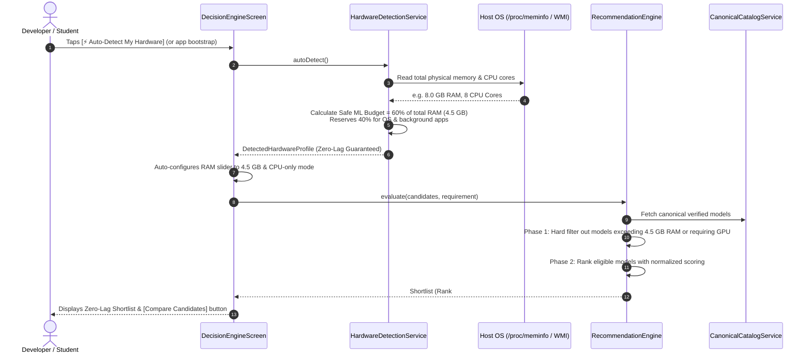

# BroML — System Architecture & Engineering Specification

**Product:** BroML — AI/ML Model Decision Intelligence Platform  
**Specification Version:** 1.2.0 (Blueprint 1.0 Compliant)  
**Target Environments:** Android / Mobile / Laptop / Desktop  

---

## 1. Executive Overview

**BroML** is an AI/ML Model Decision Intelligence platform that helps developers, students, and machine learning engineers select suitable machine learning models based on project requirements, real hardware limitations, latency expectations, and licensing constraints.

Rather than acting as an uncurated directory or ranking models by popularity, BroML solves the engineering question:

> *"Given my real hardware resources and deployment constraints, which models are compatible, what are their architectural trade-offs, and what evidence supports the recommendation?"*

### Core Architectural Pillars
1. **Hardware Auto-Detection & Laptop Profiling**: Dynamically discovers host memory and CPU core counts (or applies target presets like Budget 4GB Laptops) and calculates a safe ML memory budget so the user's laptop never stutters, freezes, or thermal throttles.
2. **Deterministic Recommendation & Rejection Engine**: Applies two-phase decision intelligence:
   - **Phase 1 Hard Constraint Filtering**: Incompatible candidates are eliminated with transparent, human-readable rejection reasons (RAM overflow, VRAM requirement, latency violation, license incompatibility).
   - **Phase 2 Feature Normalization & Multi-Attribute Scoring**: Eligible candidates are normalized across Benchmark Accuracy (0.35), CPU Latency (0.25), Memory Efficiency (0.20), Parameter Efficiency (0.10), and Commercial License (0.10).
3. **Side-by-Side Technical Comparison Matrix**: Compares shortlisted candidates head-to-head across latency on laptop CPUs, RAM footprint, benchmark fidelity, and key trade-offs.
4. **Verified Canonical Model Catalog**: Pre-seeded with 30 verified canonical architectures spanning all 5 ML categories (Computer Vision, NLP, Audio & Speech, Tabular ML, RL, and On-Device LLMs) with verified benchmark metrics, parameter counts, zero-lag memory footprints, and paper links.
5. **Enterprise Authentication & Threat Protection**: Multi-factor authentication (RFC 6238 TOTP), progressive rate-limiting, and Cloudflare Turnstile bot deterrence.

---

## 2. Decoupled 5-Tier System Architecture

BroML is organized around a clean, layered architecture leveraging Flutter and the **Provider** reactive state pattern (`ChangeNotifier`):



---

## 3. Hardware Auto-Detection & Laptop Profiler Architecture

To guarantee that models run smoothly without lagging on standard laptops or edge devices:



### Hardware Presets Supported:
* **Budget Laptop (4 GB RAM, CPU-Only)**: Allocates safe 2.0 GB RAM budget. Designed for dual-core and quad-core budget laptops. Highlights models like `SqueezeNet-1.1`, `MobileNetV3-Small`, `TinyBERT-4L`, and `paraphrase-MiniLM-L3-v2`.
* **Standard Work Laptop (8 GB RAM, CPU-Only)**: Allocates safe 4.5 GB RAM budget. Accommodates `EfficientNet-B0`, `ResNet-18`, `DistilBERT`, `YOLOv8n`, and `all-MiniLM-L6-v2`.
* **GPU Workstation (16 GB RAM + Dedicated VRAM)**: Allocates 10.0 GB RAM and enables GPU-accelerated architectures like `RoBERTa-Base` and `YOLOv8s`.

---

## 4. Recommendation & Scoring Formulation (Blueprint Section 8)

### Phase 1: Hard Constraint Elimination
Any model $m \in M$ is immediately disqualified if:
1. $m.\text{task} \neq R.\text{task}$
2. $m.\text{minRamBytes} > R.\text{availableRamBytes}$
3. $R.\text{cpuOnly} = \text{true} \land m.\text{minVramBytes} > 0$
4. $R.\text{maxLatencyMs} \neq \text{null} \land m.\text{latencyMs} > R.\text{maxLatencyMs}$
5. $R.\text{allowedLicenses} \neq \emptyset \land m.\text{license} \notin R.\text{allowedLicenses}$

### Phase 2: Multi-Attribute Weighted Scoring
For all eligible models, features are normalized into $[0.0, 1.0]$:
* **Accuracy Score**: $S_{\text{acc}} = \frac{\text{acc} - \min(\text{acc})}{\max(\text{acc}) - \min(\text{acc}) + \epsilon}$
* **Latency Score**: $S_{\text{lat}} = \frac{\max(\text{lat}) - \text{lat}}{\max(\text{lat}) - \min(\text{lat}) + \epsilon}$
* **RAM Efficiency**: $S_{\text{ram}} = \frac{\max(\text{ram}) - \text{ram}}{\max(\text{ram}) - \min(\text{ram}) + \epsilon}$
* **Parameter Efficiency**: $S_{\text{param}} = \frac{\max(\text{params}) - \text{params}}{\max(\text{params}) - \min(\text{params}) + \epsilon}$
* **License Favorability**: Permissive (Apache 2.0 / MIT / BSD) = 1.0; Copyleft (AGPL / GPL) = 0.5.

$$\text{Total Score} = 100 \times \left( 0.35 S_{\text{acc}} + 0.25 S_{\text{lat}} + 0.20 S_{\text{ram}} + 0.10 S_{\text{param}} + 0.10 S_{\text{lic}} \right)$$

---

## 5. Side-by-Side Model Comparison Matrix (Blueprint Section 7)

When 2 or more candidate models are shortlisted, `ModelComparisonScreen` renders a head-to-head technical matrix:

| Metric Evaluated | Purpose & Diagnostic Value |
| :--- | :--- |
| **Laptop Feasibility Badge** | Identifies if model runs sub-30ms without lagging on typical laptop CPUs |
| **Inference Latency** | Actual benchmark millisecond latency on standard CPU hardware |
| **RAM Footprint** | Physical memory occupied by model weights and runtime tensor buffers |
| **Parameter Count & Disk Size** | Model compression footprint and storage overhead |
| **Benchmark Accuracy** | Standard evaluation metric (ImageNet Top-1, COCO mAP50-95, GLUE SST-2, MTEB) |
| **Commercial License** | Identifies license compatibility for enterprise and commercial distribution |
| **Key Trade-off Summary** | Human-readable explanation of why a developer would pick Model A over Model B |

---

## 6. Directory Hierarchy

```text
meet_app/
├── lib/
│   ├── main.dart                          # Application bootstrap & route configuration
│   ├── models/
│   │   ├── ml_model.dart                  # Model entity with technical specs & laptop feasibility
│   │   ├── project_requirement.dart       # Project constraints & hardware limits
│   │   └── decision_record.dart           # Persistent decision snapshot & trade-off rationale
│   ├── services/
│   │   ├── hardware_detection_service.dart # Real host hardware scanner & laptop presets
│   │   ├── recommendation_engine.dart     # Hard filtering & multi-attribute scoring
│   │   ├── canonical_catalog_service.dart # 16 verified canonical models
│   │   ├── security_engine.dart           # TOTP MFA, brute-force mitigation & audit logging
│   │   └── firestore_service.dart         # Cloud synchronization & data persistence
│   ├── screens/
│   │   ├── main_shell_screen.dart         # 3-tab modern shell
│   │   ├── decision_engine_screen.dart    # Requirement builder, auto-detect & shortlist
│   │   ├── model_comparison_screen.dart   # Side-by-side technical matrix
│   │   ├── model_list_screen.dart         # Model catalog with feasibility HUD
│   │   ├── model_detail_screen.dart       # Deep model inspector & evidence links
│   │   └── saved_decisions_screen.dart    # Decision history & audit reports
│   └── widgets/
│       ├── model_card.dart                # Model card with memory footprint & laptop badges
│       └── account_menu.dart              # Reusable profile & session menu
└── test/
    ├── hardware_detection_test.dart       # Hardware auto-detect & preset tests
    ├── recommendation_engine_test.dart    # Constraint filtering & scoring verification
    ├── widget_test.dart                   # Main shell navigation & session lifecycle
    └── security_audit_test.dart           # Authentication & rate-limit tests
```
