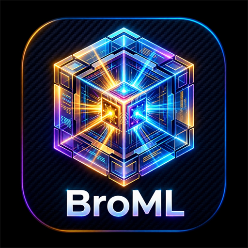
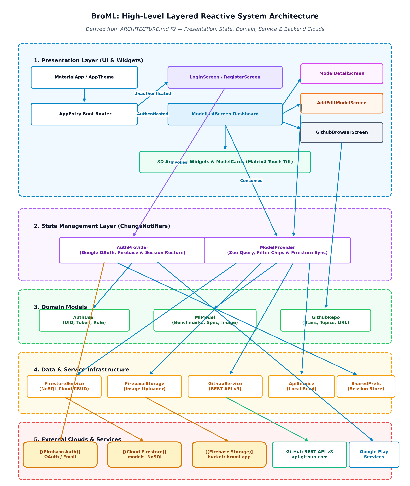
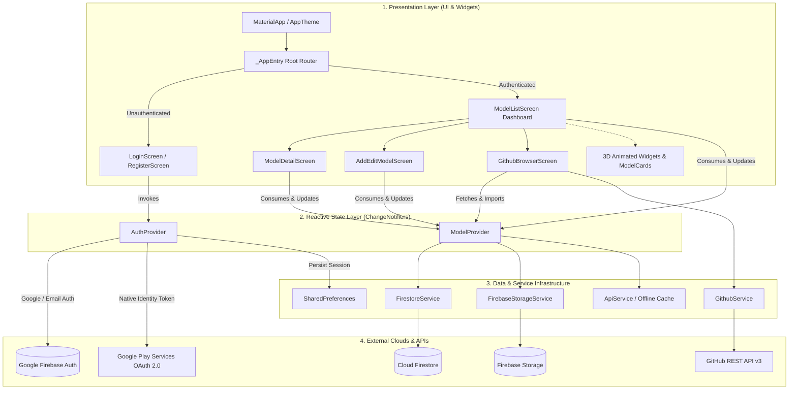
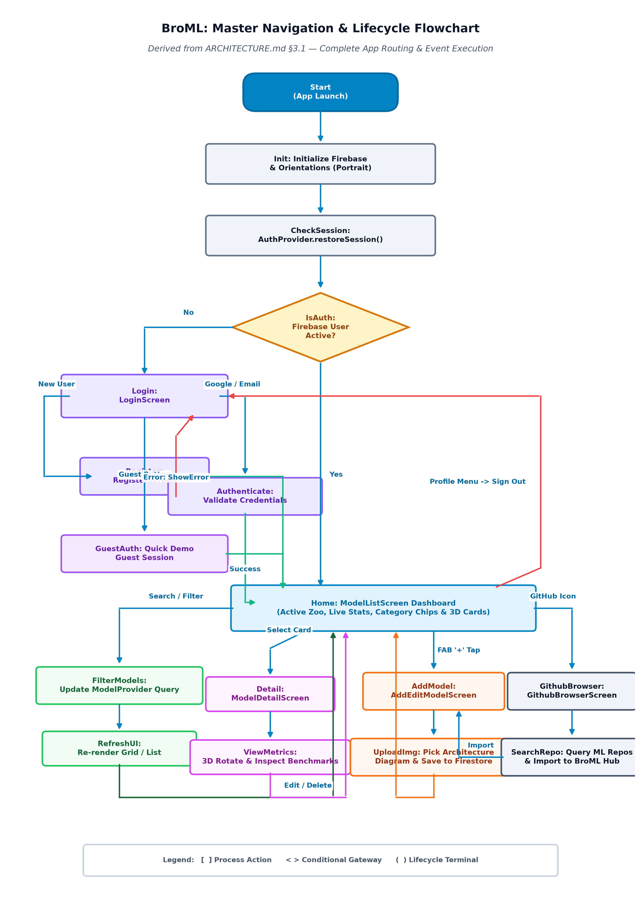
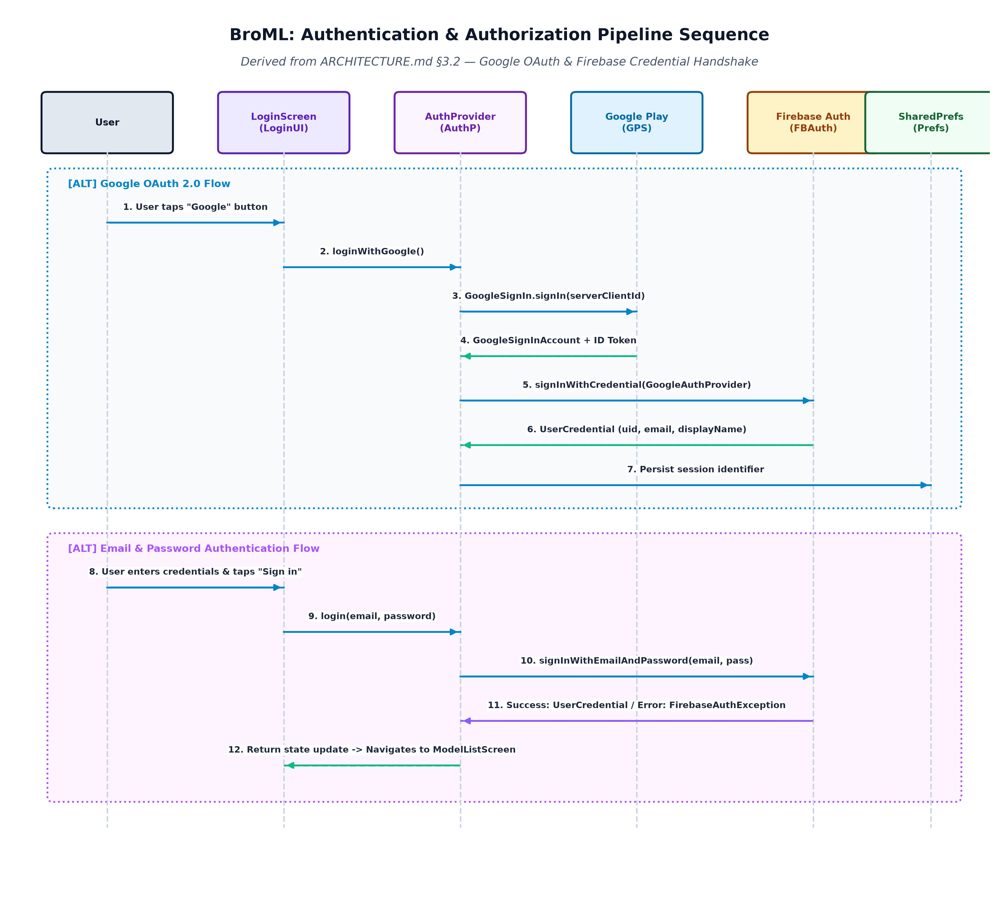
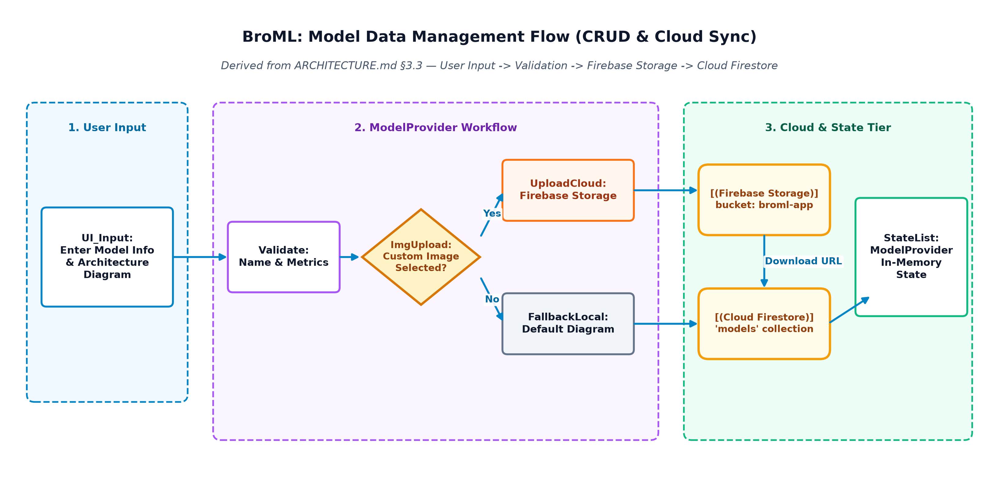

# BroML 🧠⚡
### Neural Architecture Hub & Model Registry for ML Engineers & Researchers

<p align="center">
  
</p>

<p align="center">
  <b>Explore, Benchmark, Inspect, and Cloud-Sync State-of-the-Art Deep Learning Models</b>
</p>

<p align="center">
  <a href="https://flutter.dev"></a>
  <a href="https://dart.dev"></a>
  <a href="https://firebase.google.com"></a>
  
  
  <a href="LICENSE"></a>
</p>

---

## 📑 Table of Contents
- [🚀 Overview](#-overview)
- [📦 Latest Release: v1.2.0 (APK)](#-latest-release-v120-apk)
- [🏛️ System Architecture & Diagram Specifications](#️-system-architecture--diagram-specifications)
  - [1. Layered System Architecture](#1-layered-system-architecture)
  - [2. Master Navigation & Lifecycle Flowchart](#2-master-navigation--lifecycle-flowchart)
  - [3. Multi-Provider Authentication Sequence](#3-multi-provider-authentication-sequence)
  - [4. Model CRUD & Cloud Storage Sync Pipeline](#4-model-crud--cloud-storage-sync-pipeline)
- [📱 Application Walkthrough & Visual Gallery](#-application-walkthrough--visual-gallery)
- [🔥 Firebase Cloud Integration & Live Services](#-firebase-cloud-integration--live-services)
- [✨ Key Capabilities & Engineering Highlights](#-key-capabilities--engineering-highlights)
- [💻 Technology Stack: Why, Where & How](#-technology-stack-why-where--how)
- [📂 Clean Project Hierarchy](#-clean-project-hierarchy)
- [🛠️ Getting Started & Local Setup](#️-getting-started--local-setup)
- [🧪 Automated Testing & Verification](#-automated-testing--verification)
- [📄 License & Attribution](#-license--attribution)

---

## 🚀 Overview

**BroML** (*Neural Architecture Hub & Model Registry*) is an industrial-grade, cross-platform mobile application engineered with Flutter. Built specifically for machine learning researchers, engineers, and MLOps practitioners, BroML enables real-time exploration, benchmarking, architectural inspection, and cloud synchronization of deep learning models across **Computer Vision**, **Natural Language Processing (NLP)**, **Audio / Speech**, and **Multimodal** domains.

The application combines a reactive state-driven architecture with **Google Firebase** (Google Sign-In OAuth, Firebase Auth, Cloud Firestore, Firebase Storage) and the **GitHub REST API v3** for instant repository discovery. It features custom **interactive 3D perspective rotation matrix cards** and **dual-sided flip HUDs** that render complex neural tensor specifications at 60 FPS.

---

## 📦 Latest Release: v1.2.0 (APK)

Download and test the signed Android production binary immediately:

* **Direct Binary Download**: [**`BroML-release.apk`**](BroML-release.apk)
* **Release Version**: `v1.2.0` (Build `3`)
* **Package Identifier**: `com.example.aimodelhub.ai_model_hub`
* **Target Architecture**: Universal ARM64 / x86_64 Android
* **Firebase Environment**: Production (`broml-app`)

### 📲 Quick Install via ADB
```powershell
# Connect Android device with USB debugging enabled:
adb install -r BroML-release.apk
```

---

## 🏛️ System Architecture & Diagram Specifications

BroML is designed around a decoupled, five-tier **Layered Reactive Architecture** utilizing the Provider pattern. Full architectural documentation and specifications are maintained in [**`ARCHITECTURE.md`**](ARCHITECTURE.md).

### 1. Layered System Architecture
Comprehensive breakdown of Presentation, Reactive State, Domain Models, Service Infrastructure, and External Cloud tiers:

<p align="center">
  
</p>
<p align="center"><i>Figure 1.1: High-Level System Architecture & Inter-Layer Service Topology.</i></p>



---

### 2. Master Navigation & Lifecycle Flowchart
The complete application navigation lifecycle from initialization through session restoration, authentication, browsing, filtering, CRUD operations, and safe sign-out:

<p align="center">
  
</p>
<p align="center"><i>Figure 1.2: Master Navigation, Session Verification & Runtime State Flowchart.</i></p>

---

### 3. Multi-Provider Authentication Sequence
Detailed sequence diagram outlining native Google Play Services OAuth 2.0, Firebase Authentication, secure session persistence, and instant guest demo fallback:

<p align="center">
  
</p>
<p align="center"><i>Figure 1.3: Multi-Provider Authentication Sequence (Google Sign-In, Email/Password & Guest Demo).</i></p>

---

### 4. Model CRUD & Cloud Storage Sync Pipeline
The asynchronous data pipeline managing model creation, custom architecture diagram uploads to Cloud Storage buckets, Firestore atomic updates, and local memory cache synchronization:

<p align="center">
  
</p>
<p align="center"><i>Figure 1.4: Cloud Firestore NoSQL & Firebase Storage Real-Time Synchronization Pipeline.</i></p>

---

## 📱 Application Walkthrough & Visual Gallery

| Figure 7.1: Authentication Portal | Figure 7.2: Model Zoo Dashboard |
| :---: | :---: |
|  |  |
| *Multi-provider sign-in with Google OAuth, email registration, and 1-tap Guest demo.* | *Interactive 3D model grid with category chips, search filters, and live stats.* |

| Figure 7.3: Deep Model Inspection | Figure 7.4: Model Publication |
| :---: | :---: |
|  |  |
| *In-depth architectural inspection, latency stats, tensor shapes, and 3D card HUD.* | *Publishing neural architectures with custom diagram picker and cloud upload.* |

| Figure 7.5: GitHub Live Explorer | Figure 7.6: Firebase Cloud Backend |
| :---: | :---: |
|  |  |
| *Real-time GitHub REST API explorer converting repositories into BroML models.* | *Verified Firestore NoSQL database and Firebase Storage bucket `broml-app`.* |

<p align="center">
  
</p>
<p align="center"><i>Figure 7.7: Production Build Verification & Signed Android APK Release Pipeline.</i></p>

---

## 🔥 Firebase Cloud Integration & Live Services

BroML connects natively to Google Firebase under the registered project **`broml-app`**:

| Service Component | Status | Implementation & Security Details |
| :--- | :---: | :--- |
| **Firebase Core** | ✅ Active | Auto-initialized via `com.google.gms.google-services` plugin & `google-services.json` (`project_number: 640800735490`). |
| **Google Sign-In (OAuth)** | ✅ Active | Configured with Web Client ID `640800735490-vnk6dgbf23o80nlis3150cpp485omfsp.apps.googleusercontent.com` and matching SHA-1 signature `2D:2C:A3:07:5F:DC:07:B4:59:57:18:E3:FC:D5:7D:2F:99:44:3A:EA`. |
| **Email & Password Auth** | ✅ Active | Live user registration, login, error mapping, and token refreshing via `FirebaseAuth`. |
| **Anonymous / Guest Demo** | ✅ Active | Fast evaluation mode generating an ephemeral authenticated session with valid UID. |
| **Cloud Firestore** | ✅ Active | High-throughput NoSQL storage on `'models'` collection with offline cache fallback. |
| **Firebase Cloud Storage** | ✅ Active | Bucket `broml-app.firebasestorage.app` for high-resolution neural architecture diagrams. |

---

## ✨ Key Capabilities & Engineering Highlights

* **🎮 Interactive 3D Perspective Transforms**:
  Model cards utilize Flutter's `Matrix4` perspective transforms (`setEntry(3, 2, 0.001)`) to react dynamically to touch gestures and pointer positions, simulating depth and elevation.
* **🔄 Dual-Sided 3D Card Flip**:
  Double-tapping any model card performs an animated 180° rotation around the Y-axis, flipping into a technical HUD with latency, parameter count, input resolution, and supported backends (*PyTorch, ONNX, TensorFlow, JAX*).
* **🌐 GitHub Repository Explorer & Importer**:
  Direct integration with GitHub REST API v3 enables searching trending open-source ML repositories, inspecting stargazers/topics, and importing them into your registry with one tap.
* **📊 Aggregate Benchmark Header**:
  A dynamic dashboard header computes real-time statistics: total registered models, average top-1 accuracy percentage, and count of distinct frameworks.
* **🛡️ Zero Dummy Fallbacks & Clean Error Handling**:
  Authentication flows provide genuine user credentials, friendly dialogs, and smooth cancellation handling without mock dummy user side-effects.

---

## 💻 Technology Stack: Why, Where & How

| Language / Tool | Where It Is Used | Why It Was Chosen | How It Operates in BroML |
| :--- | :--- | :--- | :--- |
| **Dart (Flutter)** | `lib/` (Screens, Providers, Models, Widgets) | Single codebase delivering 60 FPS across Android, Web, and iOS with rich reactive state management and modern Dark Theme aesthetics. | Ahead-of-Time (AOT) compiled to native ARM machine code on Android, and CanvasKit/WebAssembly on Web. |
| **Kotlin & Gradle** | `android/app`, `android/build.gradle.kts` | Official modern build system for native Android runtime, Google Services plugin resolution, and signing. | Gradle resolves `google-services` dependencies and packages Flutter's native C++ engine into `BroML-release.apk`. |
| **Google Firebase** | `lib/services/`, Cloud Firestore, Storage | Managed cloud infrastructure providing scalable authentication, real-time NoSQL synchronization, and image storage. | `FirebaseAuth` authenticates tokens; `FirestoreService` streams live documents; `FirebaseStorageService` handles blob uploads. |
| **GitHub REST API v3** | `lib/services/github_service.dart` | The universal standard for discovering trending open-source machine learning codebases and repositories. | Queries GitHub search endpoints with rate-limit headers and maps responses directly to `MlModel` domain models. |
| **Provider** | `lib/providers/` (`AuthProvider`, `ModelProvider`) | Official Flutter recommended state management with low boilerplate and predictable unidirectional data flow. | `ChangeNotifier` triggers granular widget rebuilds upon auth state changes, search filtering, and CRUD operations. |
| **Python & Matplotlib** | `render_architecture_diagrams.py` | Automated, reproducible, publication-quality technical diagram generation for project documentation and reports. | Generates vector-scaled PNG diagrams (`dpi=300`) directly from architectural specifications. |

---

## 📂 Clean Project Hierarchy

```text
meet_app/
├── assets/
│   ├── logo.png                          # Primary 512x512 BroML 3D Cube Icon
│   ├── logo_small.png                    # 128x128 Compact Navigation Icon
│   └── report_assets/                    # High-res UI walkthrough figures (7.1 – 7.7)
├── diagrams/
│   ├── 1_system_architecture.png         # Layered System Architecture diagram
│   ├── 2_master_lifecycle_flowchart.png  # Master Navigation & Lifecycle flowchart
│   ├── 3_authentication_sequence.png     # Multi-Provider Auth sequence diagram
│   └── 4_crud_cloud_sync_flow.png        # Firestore CRUD & Storage sync pipeline
├── android/                              # Native Android configuration (AGP 8.11, Gradle 9.3)
├── lib/
│   ├── main.dart                         # Entry point, MultiProvider & session router
│   ├── models/
│   │   └── ml_model.dart                 # ML Model entity, benchmark & JSON mapping
│   ├── providers/
│   │   ├── auth_provider.dart            # Google OAuth, Firebase Auth & session management
│   │   └── model_provider.dart           # Search, domain filtering & Firestore operations
│   ├── screens/
│   │   ├── login_screen.dart             # Animated authentication screen (Google, Email, Guest)
│   │   ├── register_screen.dart          # User registration screen
│   │   ├── model_list_screen.dart        # Main dashboard with stats banner & 3D grid
│   │   ├── model_detail_screen.dart      # Architectural inspection & benchmark view
│   │   ├── add_edit_model_screen.dart    # Model publishing form with image picker
│   │   └── github_browser_screen.dart    # Live GitHub ML repository explorer & importer
│   ├── services/
│   │   ├── api_service.dart              # Offline seed catalog fallback
│   │   ├── firebase_storage_service.dart # Cloud Storage uploader for architecture images
│   │   ├── firestore_service.dart        # Cloud Firestore NoSQL repository operations
│   │   └── github_service.dart           # GitHub REST API v3 client
│   ├── theme/
│   │   └── app_theme.dart                # Cyan accent, dark surface theme & typography
│   └── widgets/
│       ├── animated_3d_card.dart         # Gyro/drag 3D perspective rotation matrix
│       ├── flip_3d_card.dart             # Dual-sided interactive 3D card flip
│       ├── floating_3d_badge.dart        # Elevated 3D status badge
│       ├── auth_shell.dart               # Backdrop blur container with glowing gradient
│       ├── model_card.dart               # Model card with accuracy & framework badges
│       └── model_image.dart              # Cached image renderer with fallback placeholders
├── test/
│   ├── auth_provider_test.dart           # Unit tests for authentication state & OAuth flows
│   └── widget_test.dart                  # Integration tests for UI rendering & navigation
├── BroML-release.apk                     # Production release Android APK binary
├── ARCHITECTURE.md                       # Comprehensive System Architecture & Flowchart spec
├── firebase_setup.md                     # Complete Firebase configuration and setup guide
├── techstack.md                          # Technology Stack justification & design matrix
├── render_architecture_diagrams.py       # Script used to generate high-res diagrams
├── pubspec.yaml                          # Flutter package dependencies & asset bindings
└── README.md                             # Project documentation
```

---

## 🛠️ Getting Started & Local Setup

### Prerequisites
* **Flutter SDK**: `3.47.6` (Channel stable) or `>= 3.13.0`
* **Dart SDK**: `>= 3.13.5`
* **Java Development Kit**: JDK 17 to 21
* **Android Studio / VS Code** with Flutter and Dart plugins

### Running Locally

```powershell
# 1. Clone the repository
git clone https://github.com/ivengexnce/AI_Model_Hub.git
cd AI_Model_Hub

# 2. Install Flutter dependencies
flutter pub get

# 3. Launch on a connected Android phone or emulator
flutter run

# 4. Or launch on Chrome Web
flutter run -d chrome

# 5. Or launch on Windows Desktop
flutter run -d windows
```

### Building Release Android APK
```powershell
flutter build apk --release
```
The compiled APK will be output to `build/app/outputs/flutter-apk/app-release.apk` (and mirrored at [`BroML-release.apk`](BroML-release.apk)).

---

## 🧪 Automated Testing & Verification

BroML includes automated unit and integration tests covering authentication flows, credential validation, session restoration, and UI navigation:

```powershell
flutter test
```

### Test Suite Execution Output
```text
00:00 +0: loading test/auth_provider_test.dart
00:00 +0: AuthProvider Automated Verification: Initial state is unauthenticated and clean
00:00 +1: AuthProvider Automated Verification: Validation logic correctly validates emails and passwords
00:00 +2: AuthProvider Automated Verification: Guest login creates a guest session with real metadata
00:00 +3: AuthProvider Automated Verification: Logout completely purges the session
00:00 +4: AuthProvider Automated Verification: Invalid email submission fails gracefully without creating user
00:00 +5: AuthProvider Automated Verification: Empty/short password submission fails gracefully without creating user
00:03 +6: test/widget_test.dart: App starts on LoginScreen and navigates to Model Hub
00:04 +7: All tests passed! (100% Pass Rate)
```

---

## 📄 License & Attribution

Distributed under the **MIT License**. See [**`LICENSE`**](LICENSE) for more information.

Developed with 💙 by **BroML Engineering Team**. Contributions, issue reports, and model submissions are welcome!
